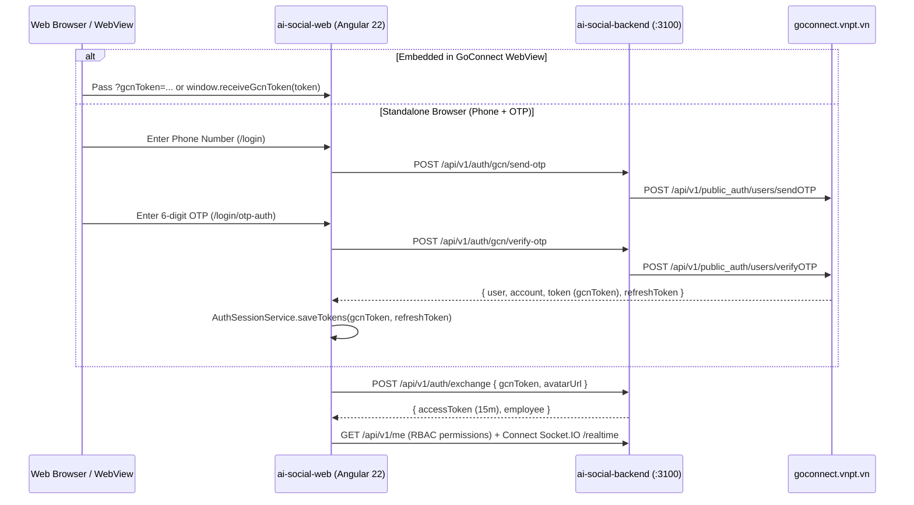

# Phase 02: GoConnect Phone+OTP Auth, Token Exchange & WebView Auto-Login

## Context Links
- [Overview Plan](./plan.md)
- [Research 01: Auth, Token Exchange & SSO Readiness](./research/researcher-01-auth-sso-and-backend-integration.md)
- Reference `gcn-web` Auth Files:
  - `/Users/vinhcuong/Dev/gcn-web/src/app/auth/login/login.component.ts`
  - `/Users/vinhcuong/Dev/gcn-web/src/app/auth/login/otp-auth/otp-auth.component.ts`
  - `/Users/vinhcuong/Dev/gcn-web/src/app/services/auth-session.service.ts`
- Reference Backend Exchange: `/Users/vinhcuong/Dev/ai-social-backend/apps/api/src/auth/services/token-exchange.service.ts`

## Overview
- **Priority**: P1 (Core Auth)
- **Current Status**: Planned
- **Effort**: 3h
- **Brief Description**: Port and streamline the **Phone + OTP** login flow (`LoginComponent` + `OtpAuthComponent` + `AuthSessionService`) from `/Users/vinhcuong/Dev/gcn-web` (removing password & external SSO buttons per user requirement), add CORS-safe GoConnect OTP proxy endpoints on `ai-social-backend`, exchange `gcnToken` for `ai-social-backend`'s internal JWT (`POST /api/v1/auth/exchange` + `GET /api/v1/me`), and support zero-click auto-login inside GoConnect Mobile WebView.

## Key Insights
- `/Users/vinhcuong/Dev/gcn-web` already implements the exact GoConnect Phone + OTP flow (`sendOTP` -> 120s `CountdownTimerComponent` -> `verifyOTP`) with VNPT branding and terms modals.
- Streamlining `LoginComponent` to focus strictly on **Phone + OTP** keeps the code under 200 lines and follows KISS/YAGNI.
- After `verifyOTP` returns `{ user, account, token, refreshToken }`, `AiSocialAuthService` saves `gcnToken` in `localStorage` and calls `POST /api/v1/auth/exchange { gcnToken }` on `ai-social-backend` (`:3100`) to obtain the 15-minute internal `accessToken` + RBAC permissions (`GET /api/v1/me`).

## Requirements
### Functional Requirements
1. **Phone Input Screen (`LoginComponent` — `/login`)**:
   - Ported from `gcn-web/src/app/auth/login/`: validate Vietnamese phone number (`PHONENUMBER_REGEX`), check terms checkbox, call `sendOtp(phone)`, store `otp_create_date` in `localStorage` (skip re-sending if `< 2` minutes remaining), and navigate to `/login/otp-auth`.
   - Include a Dev/Local quick-login helper (visible only in non-prod/localhost) to test with seeded employee tokens without SMS cost.
2. **OTP Verification Screen (`OtpAuthComponent` — `/login/otp-auth`)**:
   - Ported from `gcn-web/src/app/auth/login/otp-auth/`: display masked phone number (`087925****`), 6-digit OTP input, 120s `CountdownTimerComponent`, resend OTP button, and call `verifyOtp(phone, otp, true)`.
3. **Token Exchange & Session Persistence (`AiSocialAuthService` + `AuthSessionService`)**:
   - Persist `gcnToken`, `gcnRefreshToken`, `gcnUser`, and `aiSocialAccessToken` in `localStorage` with Angular Signals (`currentUser`, `permissions`, `isAuthenticated`).
   - Exchange `gcnToken` via `POST /api/v1/auth/exchange` and hydrate RBAC (`roles`, `publisherChannels`, `canBroadcastEmergency`) via `GET /api/v1/me`.
   - Sync `user.user_avatar_thumb` from `verifyOTP` so user avatars display accurately.
   - On browser refresh (`F5`), `authGuard` restores session automatically from stored tokens.
4. **GoConnect Mobile WebView Auto-Login**:
   - Detect `?gcnToken=<jwt>` query param or `window.receiveGcnToken(token)` callback on startup -> automatically run `exchangeToken(gcnToken)` and enter the requested channel/post without showing `/login`.

### Non-Functional Requirements
- Every component and service file strictly `< 200` lines.
- Clear Vietnamese validation and error messages matching `gcn-web`.

## Architecture

## Related Code Files
- **Create in `/Users/vinhcuong/Dev/ai-social-web/src/app/`**:
  - `core/services/auth-session.service.ts` (adapted from `gcn-web`)
  - `core/services/ai-social-auth.service.ts` (`sendOtp`, `verifyOtp`, `exchangeToken`, `fetchMe`, `logout`)
  - `core/guards/auth.guard.ts` & `redirect-if-logged-in.guard.ts`
  - `auth/login/login.component.ts`, `.html`, `.scss` (streamlined Phone step from `gcn-web`)
  - `auth/otp-auth/otp-auth.component.ts`, `.html`, `.scss` (OTP step from `gcn-web`)
- **Modify in `/Users/vinhcuong/Dev/ai-social-backend/apps/api/src/auth/`**:
  - Add `/api/v1/auth/gcn/send-otp`, `/api/v1/auth/gcn/verify-otp`, and `/api/v1/auth/gcn/refresh` proxy endpoints to avoid browser CORS against `goconnect.vnpt.vn` and sync `avatarUrl`.

## Implementation Steps
1. Add GoConnect OTP proxy endpoints (`/api/v1/auth/gcn/send-otp`, `/api/v1/auth/gcn/verify-otp`, `/api/v1/auth/gcn/refresh`) in `ai-social-backend`.
2. Port `AuthSessionService` and create `AiSocialAuthService` managing both `gcnToken` and `aiSocialAccessToken` + RBAC Signals.
3. Port `LoginComponent` (`/login`) and `OtpAuthComponent` (`/login/otp-auth`) from `gcn-web`, keeping only the Phone + OTP flow.
4. Implement `authGuard` and `redirectIfLoggedInGuard` supporting `?redirect=` deep-link preservation and `?gcnToken=` WebView auto-login.

## Todo List
- [ ] Add CORS-safe GoConnect OTP proxy routes in `ai-social-backend`
- [ ] Implement `AuthSessionService` and `AiSocialAuthService` (token exchange + RBAC hydration)
- [ ] Port Phone-only `LoginComponent` (`/login`) from `gcn-web`
- [ ] Port `OtpAuthComponent` (`/login/otp-auth`) with 120s countdown timer from `gcn-web`
- [ ] Implement route guards and WebView `?gcnToken=` / `window.receiveGcnToken` auto-login

## Success Criteria
- User can log in with Phone + OTP, exchange token with `ai-social-backend`, load `/api/v1/me` permissions, and stay logged in across browser refreshes (`F5`).
- Opening `?gcnToken=<jwt>` logs in automatically without displaying `/login`.

## Risk Assessment
- **Browser CORS on `goconnect.vnpt.vn`**: Eliminated by proxying OTP requests through `ai-social-backend`.

## Security Considerations
- On logout, clear all `localStorage` keys (`gcn_token`, `gcn_refresh_token`, `ai_social_access_token`, `gcn_user`) and disconnect Socket.IO.

## Next Steps
- Proceed to [Phase 03: Desktop Web Shell, 4-Channel Views & Deep-Link Routing](./phase-03-desktop-web-shell-and-4-channel-navigation.md).
