# Phase 04: Web Composer, Native `File`/`Blob` S3 Upload, Polls/Events & Split-Pane PDF Viewer

## Context Links
- [Overview Plan](./plan.md)
- [Phase 03: Desktop Web Shell & 4-Channel Views](./phase-03-desktop-web-shell-and-4-channel-navigation.md)
- Reference `gcn-web` Preview Modals:
  - `/Users/vinhcuong/Dev/gcn-web/src/app/home/component/gcn-image-preview-modal/`
  - `/Users/vinhcuong/Dev/gcn-web/src/app/home/component/gcn-video-preview-modal/`
  - `/Users/vinhcuong/Dev/gcn-web/src/app/home/component/gcn-file-preview-modal/`
- Backend Media Controller: `/Users/vinhcuong/Dev/ai-social-backend/apps/api/src/media/media.controller.ts`

## Overview
- **Priority**: P1 (Publisher & Rich Media Features)
- **Current Status**: Planned
- **Effort**: 4h
- **Brief Description**: Build the RBAC-gated **Inline Post Composer & Modal** (`InlineComposerCardComponent`), implement zero-RAM native browser `File`/`Blob` streaming upload to S3/MinIO presigned URLs (`AiSocialS3UploadService`), support Poll creation, Event metadata creation, Target Unit tree selector, and native HTML5 PDF/Video/Image previewing.

## Key Insights
- Unlike Flutter Web (which forced reading entire 100MB videos into a `Uint8List` in WASM RAM), Angular/Browser `<input type="file">` returns a native `File` (`Blob` pointer to disk). Passing `file` directly to `fetch(uploadUrl, { method: 'PUT', body: file, headers: { 'Content-Type': file.type } })` or `HttpClient.put` streams the file from disk to S3/MinIO with near-zero memory overhead!
- Local image and video previews before upload use `URL.createObjectURL(file)` (instant, 0ms latency, 0 RAM copy) and revoke on destroy (`URL.revokeObjectURL`).
- Handbook PDF reader (`HandbookPdfViewerComponent`) uses native browser `<iframe [src]="safePdfUrl">` / `<object type="application/pdf">` with full zoom, page jump, search, and download toolbar — zero Canvas z-index bugs.

## Requirements
### Functional Requirements
1. **Inline Composer & Channel-Specific Forms (`src/app/features/ai-social/components/composer/`)**:
   - Visible only when `aiSocialAuth.canPublishInChannel(channelCode)` is `true`.
   - Rich text / Markdown editor with title, body, category tag, and target organizational unit picker (`GET /api/v1/org/units/tree`).
   - Channel-specific extensions:
     - `khan`: Emergency priority selector, mandatory read deadline, and optional audio/document attachments.
     - `sukien`: Event start/end time, location/meeting link, RSVP toggle, and Poll builder (`ComposerPollFormComponent`).
     - `truyenthong`: Multi-image/video gallery picker, featured post toggle, and Poll builder.
     - `sotay`: PDF attachment picker (`application/pdf`) and handbook section selector.
2. **Native `File`/`Blob` S3 Presigned Upload (`AiSocialS3UploadService`)**:
   - Step 1: Validate size limits (`Image <= 20MB`, `PDF/Doc <= 50MB`, `Video <= 100MB`).
   - Step 2: Request presigned URL via `POST /api/v1/media/upload-url { filename, mimeType, sizeBytes, channelCode, kind }`.
   - Step 3: Stream native `File` via HTTP `PUT` to `uploadUrl` with upload progress percentage (`HttpEventType.UploadProgress`).
   - Step 4: Submit `POST /api/v1/posts` with uploaded `mediaId` / `s3Key` attachments.
3. **Media Lightbox & Handbook Split-Pane PDF Viewer**:
   - Image lightbox modal (zoom, rotate, download, multi-image carousel).
   - HTML5 `<video controls preload="metadata">` player modal.
   - `HandbookPdfViewerComponent`: Native browser PDF embed (`DomSanitizer.bypassSecurityTrustResourceUrl`) + open-in-new-tab & download buttons + mandatory read acknowledgment bar.

### Non-Functional Requirements
- Zero memory spikes on large video/PDF uploads (use `File` stream + `URL.createObjectURL`).
- All component files strictly `< 200` lines.

## Architecture

```mermaid
sequenceDiagram
  participant User as Publisher (Browser)
  participant Input as HTML <input type="file">
  participant UploadSvc as AiSocialS3UploadService
  participant API as ai-social-backend (:3100)
  participant S3 as MinIO / S3 Bucket

  User->>Input: Select Image / PDF / Video
  Input-->>UploadSvc: Native Browser File (Blob)
  UploadSvc->>UploadSvc: Instant preview via URL.createObjectURL(file)
  User->>UploadSvc: Click "Đăng bài" / "Phát thông báo"
  UploadSvc->>API: POST /api/v1/media/upload-url { filename, mimeType, sizeBytes, channelCode, kind }
  API-->>UploadSvc: { uploadUrl, mediaId, s3Key }
  UploadSvc->>S3: HTTP PUT uploadUrl (body: File stream, Content-Type: file.type)
  S3-->>UploadSvc: 200 OK
  UploadSvc->>API: POST /api/v1/posts (attachments: [{ id: mediaId, fileUrl: s3Key, ... }])
```

## Related Code Files
- **Create in `/Users/vinhcuong/Dev/ai-social-web/src/app/features/ai-social/`**:
  - `services/ai-social-s3-upload.service.ts`
  - `components/composer/inline-composer-card/inline-composer-card.component.ts`
  - `components/composer/composer-attachment-strip/composer-attachment-strip.component.ts`
  - `components/composer/composer-poll-form/composer-poll-form.component.ts`
  - `components/composer/composer-event-form/composer-event-form.component.ts`
  - `components/composer/org-unit-tree-picker/org-unit-tree-picker.component.ts`
  - `components/handbook-pdf-viewer/handbook-pdf-viewer.component.ts`
  - `components/media-lightbox-modal/media-lightbox-modal.component.ts`

## Implementation Steps
1. Implement `AiSocialS3UploadService` using Angular `HttpClient` (`reportProgress: true`) to `PUT` native `File` blobs to S3 presigned URLs.
2. Build `ComposerAttachmentStripComponent` using `URL.createObjectURL(file)` for zero-copy local previews and progress bars.
3. Build `ComposerPollFormComponent`, `ComposerEventFormComponent`, and `OrgUnitTreePickerComponent` (using `nz-tree-select`).
4. Build `InlineComposerCardComponent` integrating post creation (`POST /api/v1/posts`) and post editing (`PATCH /api/v1/posts/:id`).
5. Build `HandbookPdfViewerComponent` and `MediaLightboxModalComponent`.

## Todo List
- [ ] Implement `AiSocialS3UploadService` with native `File` streaming and progress tracking
- [ ] Build `InlineComposerCardComponent` and `ComposerAttachmentStripComponent`
- [ ] Build `ComposerPollFormComponent`, `ComposerEventFormComponent`, and `OrgUnitTreePickerComponent`
- [ ] Build `HandbookPdfViewerComponent` (split-pane PDF viewer) and `MediaLightboxModalComponent`
- [ ] Verify S3/MinIO CORS allows browser `PUT` from web origin

## Success Criteria
- Publishers can attach images, videos (up to 100MB), and PDFs (up to 50MB) with smooth progress bars and publish posts across all 4 channels.
- Handbook PDFs render inline in the split-pane viewer with native browser controls.

## Risk Assessment
- **MinIO/S3 CORS for Browser `PUT`**: Configure bucket CORS to allow `PUT`, `GET`, `HEAD` and `Content-Type` header from web origins.

## Security Considerations
- Enforce MIME type and file size validation both before requesting presigned URL and on `ai-social-backend`.

## Next Steps
- Proceed to [Phase 05: Multi-Mode Sharing (Copy Link + `navigator.share` + WebView JS Bridge) & Docker/Nginx](./phase-05-sharing-webview-bridge-and-deployment.md).
