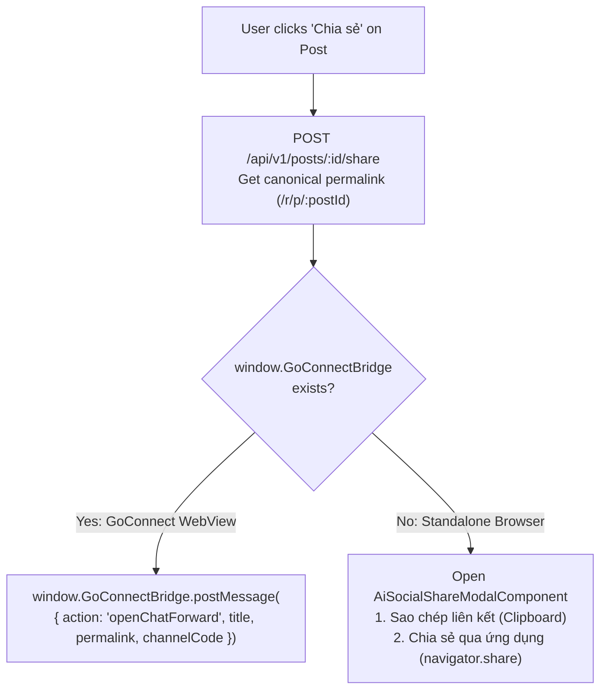

# Phase 05: Multi-Mode Sharing (Copy Link + `navigator.share` + WebView JS Bridge) & Docker/Nginx Deployment

## Context Links
- [Overview Plan](./plan.md)
- [Research 02: Angular 22 Architecture & Host Bridge](./research/researcher-02-flutter-web-port-and-host-bridge.md)
- Reference `gcn-web` Deployment:
  - `/Users/vinhcuong/Dev/gcn-web/Dockerfile`
  - `/Users/vinhcuong/Dev/gcn-web/build/default.conf`
- Reference Mobile WebView Bridge:
  - `/Users/vinhcuong/Dev/mobile-GCN-2/mobileapp/STM/lib/src/features/ai_social/gcn_ai_social_host_bridge_impl.dart`

## Overview
- **Priority**: P1 (Sharing & Production Deployment)
- **Current Status**: Planned
- **Effort**: 3h
- **Brief Description**: Implement `AiSocialHostBridgeService` and `AiSocialShareModalComponent` supporting **Copy Link (`navigator.clipboard`)**, **OS Native Web Share API (`navigator.share` to Zalo, Telegram, Mail, and GoConnect on mobile)**, and **GoConnect Mobile WebView JS Bridge (`window.GoConnectBridge.postMessage`)**, plus multi-stage Docker + Nginx SPA deployment matching `/Users/vinhcuong/Dev/gcn-web`.

## Key Insights
- Keeping sharing focused on **Copy Link + `navigator.share` + `window.GoConnectBridge`** satisfies KISS/YAGNI without coupling `ai-social-web` to `gcn-web`'s internal chat store.
- When opened on Mobile Safari/Chrome, `navigator.share({ title, text, url })` invokes the OS share sheet where GoConnect (via `receive_sharing_intent`), Zalo, and Telegram appear natively.
- When embedded inside GoConnect Mobile App WebView, `window.GoConnectBridge.postMessage(...)` opens GoConnect's native `ReceiveSharingPage.show(...)` directly.
- On Desktop browsers, the Share Sheet Modal provides a 1-click **"Sao chép liên kết"** button with toast confirmation alongside **"Chia sẻ qua hệ thống"** (`navigator.share` when supported).

## Requirements
### Functional Requirements
1. **`AiSocialHostBridgeService` (`src/app/core/services/ai-social-host-bridge.service.ts`)**:
   - Detect `isEmbeddedInGoConnectWebView()` (`typeof window.GoConnectBridge !== 'undefined'`).
   - Register `window.receiveGcnToken = (token: string) => ...` so GoConnect Mobile WebView can push tokens dynamically.
   - `sharePost({ postId, title, channelCode })`:
     - Calls `POST /api/v1/posts/:id/share` (`target: 'GOCONNECT_CHAT' | 'EXTERNAL' | 'COPY_LINK'`) to record share analytics and obtain canonical permalink (`/r/p/:postId`).
     - **If inside GoConnect WebView**: sends `{ action: 'openChatForward', title, permalink, channelCode }` via `window.GoConnectBridge.postMessage`.
     - **If in Standalone Browser**: opens `AiSocialShareModalComponent` offering:
       1. **Sao chép liên kết** (`navigator.clipboard.writeText` + fallback `<textarea>` copy for HTTP LAN testing + toast `"Đã sao chép liên kết bài viết"`).
       2. **Chia sẻ qua ứng dụng (Zalo, Telegram, GoConnect...)** via `navigator.share({ title, text, url: permalink })` (shown when `navigator.canShare` / `navigator.share` is available).
2. **Docker & Nginx Production Setup (Aligned with `gcn-web`)**:
   - Multi-stage `Dockerfile`: `node:22-alpine` builder (`npm ci && npm run build`) -> `nginxinc/nginx-unprivileged:stable-alpine`.
   - `build/default.conf`:
     - SPA fallback `try_files $uri $uri/ /index.html;` for `/channels/*`, `/posts/*`, `/r/p/*`, `/login`.
     - Reverse proxy `/api/` and `/realtime/` (WebSocket upgrade) to `ai-social-backend:3100`.

### Non-Functional Requirements
- All files `< 200` lines.
- Production bundle optimized with Angular AOT & tree-shaking.

## Architecture

## Related Code Files
- **Create in `/Users/vinhcuong/Dev/ai-social-web/`**:
  - `src/app/core/services/ai-social-host-bridge.service.ts`
  - `src/app/features/ai-social/components/share-modal/ai-social-share-modal.component.ts`
  - `Dockerfile`
  - `build/default.conf`

## Implementation Steps
1. Implement `AiSocialHostBridgeService` with typed `window.GoConnectBridge` & `window.receiveGcnToken` declarations, `navigator.share` wrapper, and HTTP-safe Clipboard copy helper.
2. Create `AiSocialShareModalComponent` displaying the post preview, permalink box, "Sao chép liên kết" button, and "Chia sẻ qua ứng dụng" (`navigator.share`) button.
3. Create `Dockerfile` and `build/default.conf` modeled on `/Users/vinhcuong/Dev/gcn-web/Dockerfile`.
4. Run unit/build verification (`npm run build`) and test end-to-end flows across all 4 channels.

## Todo List
- [ ] Implement `AiSocialHostBridgeService` (`window.GoConnectBridge`, `navigator.share`, Clipboard fallback)
- [ ] Build `AiSocialShareModalComponent`
- [ ] Create `Dockerfile` and `build/default.conf` (Nginx SPA + `/api` & `/realtime` proxy)
- [ ] Verify production build (`npm run build`) passes with 0 errors

## Success Criteria
- Clicking Share in standalone browser allows instant link copying and `navigator.share` on supported devices.
- Clicking Share inside GoConnect WebView invokes `window.GoConnectBridge.postMessage` with the exact payload expected by GoConnect Mobile.
- `npm run build` succeeds and Nginx serves deep links (`/r/p/:postId`, `/channels/:code`) without 404.

## Risk Assessment
- **`navigator.clipboard` & `navigator.share` on non-HTTPS LAN IPs**: Include automatic `<textarea>` `document.execCommand('copy')` fallback when `window.isSecureContext` is `false`.

## Security Considerations
- Validate URLs before opening external links (`http:` / `https:` only, `rel="noopener noreferrer"`).

## Next Steps
- Start Phase 01 implementation using `/cook`.
