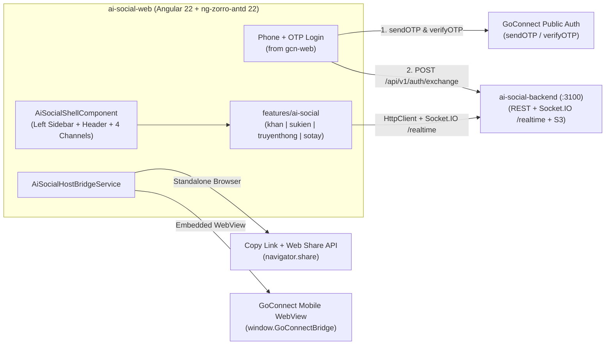

# Plan: VNPT AI Social Web (`ai-social-web` — Angular 22)

## 1. Overview
Build the standalone web application at `/Users/vinhcuong/Dev/ai-social-web` using **Angular 22 + TypeScript 6 + ng-zorro-antd 22 + Socket.IO v4** (100% aligned with `/Users/vinhcuong/Dev/gcn-web`). It reuses `gcn-web`'s core infrastructure (`AuthSessionService`, `AppIcon`, `CountdownTimerComponent`, `ThemeService`, media preview modals, SĐT + OTP login flow) while implementing the modular `features/ai-social` package (4 Official Channels: `khan`, `sukien`, `truyenthong`, `sotay`) connected to `ai-social-backend` (`:3100`), so it runs standalone and can also be mounted directly inside `gcn-web`.

## 2. Research, Brainstorm & Scout Reports
- [Brainstorm Report: Stack Evaluation (Why Angular 22 over Flutter Web)](../reports/brainstormer-261015-1438-vnpt-ai-social-web-stack-evaluation.md)
- [Research 01: Auth, Token Exchange & SSO Readiness](./research/researcher-01-auth-sso-and-backend-integration.md)
- [Research 02: Angular 22 Architecture, `gcn-web` Reuse & Host Bridge](./research/researcher-02-flutter-web-port-and-host-bridge.md)
- [Scout Report: `gcn-web` & `gcn_ai_social` Source Inventory](./reports/scout-vnpt-ai-social-web.md)

## 3. Implementation Phases

| Phase | Name | Status | Effort | File |
|---|---|---|---|---|
| 01 | Angular 22 Scaffolding & Core Infrastructure Reuse from `gcn-web` | Completed | 3h | [phase-01-project-scaffolding-and-web-decoupling.md](./phase-01-project-scaffolding-and-web-decoupling.md) |
| 02 | GoConnect Phone+OTP Auth, Token Exchange & WebView Auto-Login | Completed | 3h | [phase-02-goconnect-otp-auth-and-session-persistence.md](./phase-02-goconnect-otp-auth-and-session-persistence.md) |
| 03 | Desktop Web Shell, 4-Channel Views (`khan`, `sukien`, `truyenthong`, `sotay`) & Deep-Link Routing | Completed | 5h | [phase-03-desktop-web-shell-and-4-channel-navigation.md](./phase-03-desktop-web-shell-and-4-channel-navigation.md) |
| 04 | Web Composer, Native `File`/`Blob` S3 Upload, Polls/Events & Split-Pane PDF Viewer | Completed | 4h | [phase-04-web-composer-media-upload-and-pdf-viewer.md](./phase-04-web-composer-media-upload-and-pdf-viewer.md) |
| 05 | Multi-Mode Sharing (Copy Link + `navigator.share` + WebView JS Bridge) & Docker/Nginx | Completed | 3h | [phase-05-sharing-webview-bridge-and-deployment.md](./phase-05-sharing-webview-bridge-and-deployment.md) |

## 4. Key Architecture Diagram

## 5. Key Dependencies
- **Reference Web Codebase**: `/Users/vinhcuong/Dev/gcn-web` (`Angular 22.0.5`, `ng-zorro-antd 22.0.1`, `socket.io-client 4.8.3`, `@tiptap/core 3.29.2`, `marked 16.2.0`).
- **Backend**: `/Users/vinhcuong/Dev/ai-social-backend` (`PostgreSQL 16` with 308 employees & 5,693 units + `Redis` + `MinIO/S3`).
- **Business Logic & Figma 3.1 Reference**: `/Users/vinhcuong/Dev/mobile-GCN-2/mobileapp/STM/packages/gcn_ai_social`.
