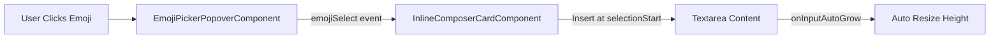

# Phase 01: Textarea Auto-grow & Emoji Picker Overlay

## Context Links
- Plan: [plan.md](./plan.md)
- Báo cáo Brainstorm: [brainstormer-261016-0950-composer-textarea-emoji-schedule-figma-sync.md](../reports/brainstormer-261016-0950-composer-textarea-emoji-schedule-figma-sync.md)
- File soạn thảo chính: [inline-composer-card.component.ts](../../src/app/features/ai-social/components/composer/inline-composer-card/inline-composer-card.component.ts)

## Overview
- **Độ ưu tiên**: Cao
- **Trạng thái**: Hoàn thành (Completed)
- **Mô tả**: Loại bỏ triệt để góc resize native xấu xí của textarea, kích hoạt khả năng tự co giãn mượt mà theo số dòng nhập liệu, và xây dựng component `EmojiPickerPopoverComponent` độc lập cho phép chọn liên tiếp nhiều icon.

## Key Insights
- Browser hiển thị góc resize `//` do thuộc tính CSS `resize: vertical`. Cần đặt `resize: none !important;` và `&::-webkit-resizer { display: none; }`.
- Thuộc tính CSS mới `field-sizing: content` hoạt động rất tốt trên Chrome/Edge/Safari mới, kết hợp hàm `onInputAutoGrow` đảm bảo hoạt động 100% trên mọi trình duyệt.
- `EmojiPickerPopoverComponent` cần giữ popup mở khi click vào emoji để người dùng có thể nhặt 3-4 icon liên tiếp mà không phải mở lại nhiều lần.

## Requirements
- Textarea không có icon kéo dãn ở góc phải.
- Chiều cao textarea tự động nở ra khi nội dung dài và co lại khi xóa bớt (tối thiểu 44px, tối đa 320px).
- Nút icon mặt cười mở Emoji Popover ngay phía trên thanh công cụ.
- Có ô tìm kiếm emoji và các tab phân loại danh mục.
- Click emoji chèn ngay vào con trỏ của trường nhập liệu hiện tại.

## Architecture

## Related Code Files
- `src/app/features/ai-social/components/composer/emoji-picker-popover/emoji-picker-popover.component.ts` (MỚI, < 100 dòng)
- `src/app/features/ai-social/components/composer/emoji-picker-popover/emoji-picker-popover.component.html` (MỚI, < 80 dòng)
- `src/app/features/ai-social/components/composer/emoji-picker-popover/emoji-picker-popover.component.scss` (MỚI, < 110 dòng)
- `src/app/features/ai-social/components/composer/inline-composer-card/inline-composer-card.component.scss` (CẬP NHẬT)
- `src/app/features/ai-social/components/composer/inline-composer-card/inline-composer-card.component.html` (CẬP NHẬT)
- `src/app/features/ai-social/components/composer/inline-composer-card/inline-composer-card.component.ts` (CẬP NHẬT)

## Implementation Steps
1. Tạo thư mục `emoji-picker-popover/` và triển khai `EmojiPickerPopoverComponent` với danh mục, tìm kiếm và grid emoji.
2. Thêm input/output và quản lý multi-select không đóng popup khi click emoji.
3. Cập nhật CSS `.borderless-textarea` trong `inline-composer-card.component.scss` với `resize: none !important; field-sizing: content;`.
4. Bổ sung hàm `onAutoGrow` và `onInsertEmoji` vào `inline-composer-card.component.ts`.
5. Tích hợp `app-emoji-picker-popover` vào template của `inline-composer-card`.

## Todo List
- [x] Tạo `EmojiPickerPopoverComponent` (TS, HTML, SCSS)
- [x] Chặn góc kéo resize trên `.borderless-textarea`
- [x] Thêm logic tự động mở rộng chiều cao textarea
- [x] Tích hợp chèn emoji đa chọn vào trường đang active
- [x] Kiểm thử biên dịch `ng build`

## Success Criteria
- Góc kéo `//` biến mất hoàn toàn.
- Textarea giãn nở mượt mà từ 1 đến nhiều dòng.
- Chọn liên tiếp nhiều emoji hoạt động trơn tru.
