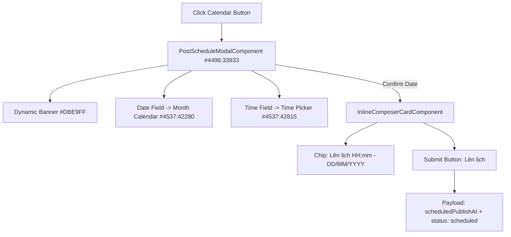

# Phase 02: Figma Schedule Modal & Payload Integration

## Context Links
- Plan: [plan.md](./plan.md)
- Báo cáo Brainstorm: [brainstormer-261016-0950-composer-textarea-emoji-schedule-figma-sync.md](../reports/brainstormer-261016-0950-composer-textarea-emoji-schedule-figma-sync.md)
- Figma Schedule Modal: Node `#4496:33933`
- Figma Calendar Tháng: Node `#4537:42280`
- Figma Time Picker: Node `#4537:42815`

## Overview
- **Độ ưu tiên**: Rất cao
- **Trạng thái**: Hoàn thành (Completed)
- **Mô tả**: Khai tử ô deadline "Đọc xong trước" cũ trong thông báo khẩn, xây dựng `PostScheduleModalComponent` độc lập chuẩn Figma 3.1 Desktop (banner `#DBE9FF`, Calendar tháng và Time picker dọc), tích hợp cơ chế đổi nhãn nút "Lên lịch" và gửi trường `scheduledPublishAt` về backend.

## Key Insights
- Khảo sát Figma Node `#4496:33933`: Banner xanh nhạt `#DBE9FF` hiển thị dynamic câu chữ: `Sẽ gửi về thứ {X}, {DD/MM/YYYY} lúc {HH:mm:ss}`.
- Node `#4537:42280` (Calendar tháng): Điều hướng tháng `← / →`, ngày hôm nay có pill `#F0F6FF`, ngày được chọn có circle bo 40px xanh `#0057E5`.
- Node `#4537:42815` (Time picker): Bảng chọn giờ/phút/buổi 3 cột, hàng được chọn highlight `#F0F6FF`, có nút "Hủy" và "Xác nhận".
- Tách thành component độc lập giúp `inline-composer-card.component.ts` duy trì dưới 170 dòng code, an toàn trước quy tắc 200 dòng.

## Requirements
- Xóa hoàn toàn khối `calendar-picker-row` ("Đọc xong trước").
- Bấm icon lịch ở toolbar mở Modal Lên lịch chuẩn Figma.
- Hiển thị đầy đủ banner thông báo thời gian hẹn, bộ chọn ngày (với calendar tháng popover), bộ chọn giờ (với time picker popover).
- Cho phép xác nhận lịch hoặc huỷ lịch đã đặt.
- Khi có lịch hẹn: hiển thị chip lịch trên composer, nút "Đăng bài" chuyển thành "Lên lịch", payload gửi `scheduledPublishAt` và `status: 'scheduled'`.

## Architecture

## Related Code Files
- `src/app/features/ai-social/components/composer/post-schedule-modal/post-schedule-modal.component.ts` (MỚI, < 150 dòng)
- `src/app/features/ai-social/components/composer/post-schedule-modal/post-schedule-modal.component.html` (MỚI, < 100 dòng)
- `src/app/features/ai-social/components/composer/post-schedule-modal/post-schedule-modal.component.scss` (MỚI, < 150 dòng)
- `src/app/features/ai-social/components/composer/inline-composer-card/inline-composer-card.component.html` (CẬP NHẬT)
- `src/app/features/ai-social/components/composer/inline-composer-card/inline-composer-card.component.ts` (CẬP NHẬT)
- `src/app/features/ai-social/utils/post-format.util.ts` (CẬP NHẬT `ComposerPayloadInput`)

## Implementation Steps
1. Khởi tạo thư mục `post-schedule-modal/` với TS, HTML, SCSS.
2. Xây dựng giao diện Modal Lên lịch theo Node `#4496:33933` (banner `#DBE9FF`, 2 trường phân đoạn).
3. Tích hợp Calendar Tháng Popover (Node `#4537:42280`) và Time Picker Popover (Node `#4537:42815`).
4. Trong `inline-composer-card.component.html`:
   - Gỡ bỏ ô nhập `deadlineText` cũ.
   - Thêm chip hiển thị lịch hẹn khi `scheduledDate()` khác null.
   - Đổi nhãn nút sang "Lên lịch".
5. Trong `inline-composer-card.component.ts`:
   - Quản lý `scheduledDate = signal<Date | null>(null)`.
   - Kết nối `scheduleConfirmed` và `scheduleCleared`.
6. Cập nhật `post-format.util.ts` để truyền `scheduledPublishAt` vào payload gửi backend.
7. Chạy `npm run build` để kiểm tra toàn diện.

## Todo List
- [x] Tạo `PostScheduleModalComponent` (TS, HTML, SCSS)
- [x] Hoàn thiện Banner dynamic và các bộ chọn Ngày/Giờ chuẩn Figma
- [x] Gỡ bỏ `deadlineText` ("Đọc xong trước") khỏi composer
- [x] Tích hợp chip lịch hẹn và chuyển đổi nút "Lên lịch"
- [x] Cập nhật `ComposerPayloadInput` và hàm build payload
- [x] Kiểm thử `npm run build`

## Success Criteria
- Modal Lên lịch hiển thị chuẩn xác Figma Node `#4496:33933`.
- Calendar tháng và Time picker hoạt động trực quan, chọn mượt mà.
- Bài viết lên lịch gửi đúng `scheduledPublishAt` và `status: 'scheduled'`.
- Toàn bộ files duy trì dưới 200 dòng.
