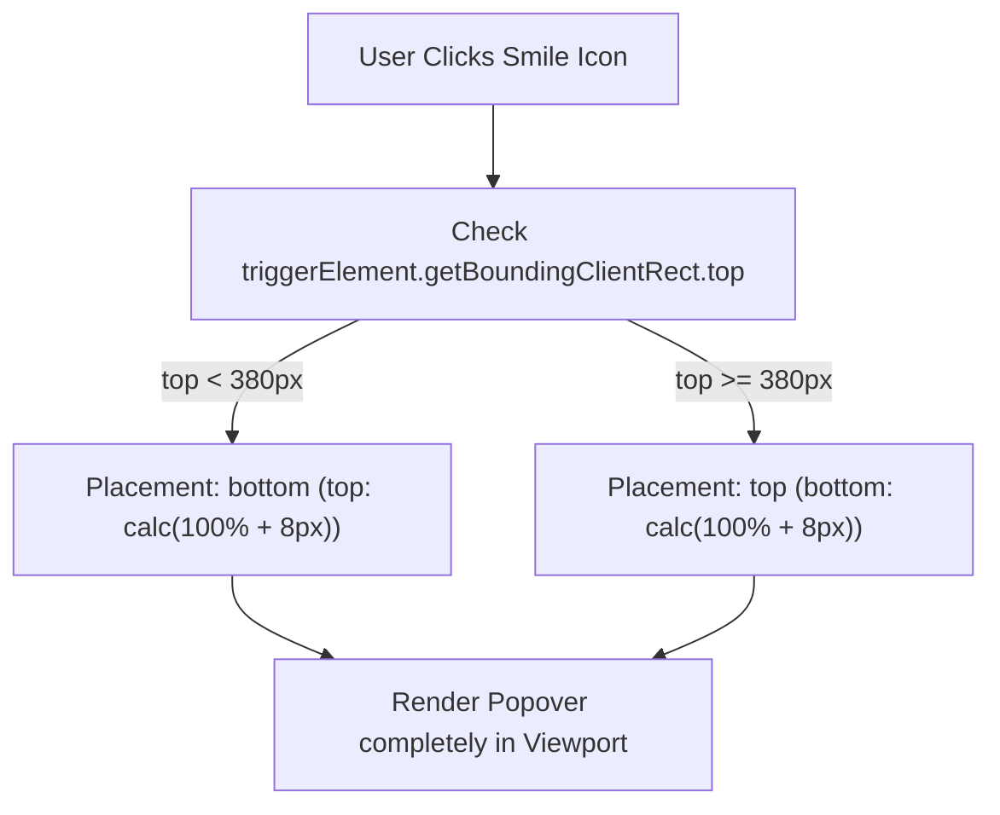

# Phase 01: Emoji Popover Dynamic Flip & Tip Removal

## Context Links
- Plan tổng quan: [plan.md](./plan.md)
- Báo cáo Brainstorm: [brainstormer-261016-1025-composer-emoji-position-schedule-modal-fix.md](../reports/brainstormer-261016-1025-composer-emoji-position-schedule-modal-fix.md)
- Component Emoji Popover: [emoji-picker-popover.component.ts](../../src/app/features/ai-social/components/composer/emoji-picker-popover/emoji-picker-popover.component.ts)

## Overview
- **Độ ưu tiên**: Cao
- **Trạng thái**: Hoàn thành (Completed)
- **Mô tả**: Bổ sung cơ chế tự động phát hiện khoảng trống màn hình và chuyển hướng mở popover (Dynamic Flip: `top` vs `bottom`). Xóa bỏ hoàn toàn dòng chữ hướng dẫn dư thừa `"Chọn liên tiếp để chèn nhiều biểu tượng"` theo yêu cầu người dùng.

## Key Insights
- Trong CSS hiện tại, `:host` có thuộc tính cứng `bottom: calc(100% + 10px)`. Khi người dùng mở emoji ở trạng thái card thu gọn (chiều cao ~56px) hoặc gần đỉnh trình duyệt, popover cao ~380px bị đẩy lên trên mép màn hình 260px (Hình 1).
- Kiểm tra `triggerElement.getBoundingClientRect().top`: Nếu khoảng cách phía trên < 380px, gán placement `bottom` (`top: calc(100% + 8px); bottom: auto`). Ngược lại gán placement `top` (`bottom: calc(100% + 8px); top: auto`).
- Dòng chữ `"Chọn liên tiếp để chèn nhiều biểu tượng"` tại footer template không cần thiết, xóa bỏ sẽ giảm chiều cao popover ~30px.

## Requirements
1. Popover không bao giờ bị cắt cụt ở mép trên màn hình dù mở ở card thu gọn hay card mở rộng.
2. Dòng tip dư thừa ở cuối popover bị xóa bỏ hoàn toàn.
3. Giữ nguyên khả năng chọn liên tiếp nhiều emoji (Multi-select), ô tìm kiếm và tab danh mục.
4. Đảm bảo toàn bộ các file liên quan duy trì dưới 200 dòng.

## Architecture

## Related Code Files
- `src/app/features/ai-social/components/composer/emoji-picker-popover/emoji-picker-popover.component.ts` (CẬP NHẬT)
- `src/app/features/ai-social/components/composer/emoji-picker-popover/emoji-picker-popover.component.html` (CẬP NHẬT)
- `src/app/features/ai-social/components/composer/emoji-picker-popover/emoji-picker-popover.component.scss` (CẬP NHẬT)

## Implementation Steps
1. Trong `emoji-picker-popover.component.ts`:
   - Inject `ElementRef`.
   - Khai báo `readonly placement = signal<'top' | 'bottom'>('bottom')`.
   - Khi `visible` chuyển thành `true`, tính toán vị trí nút trigger và cập nhật signal `placement`.
2. Trong `emoji-picker-popover.component.html`:
   - Gỡ bỏ khối `
...
`.
   - Gắn class động `[class.placement-top]="placement() === 'top'"` và `[class.placement-bottom]="placement() === 'bottom'"`.
3. Trong `emoji-picker-popover.component.scss`:
   - Cập nhật styles `:host` và `.emoji-popover-card` cho hai class `.placement-top` và `.placement-bottom`.
   - Xóa bỏ class `.popover-footer-tip`.
4. Kiểm thử biên dịch `npm run build`.

## Todo List
- [x] Bổ sung logic tính toán `placement` trong `EmojiPickerPopoverComponent`
- [x] Xóa bỏ `
` trong HTML và SCSS
- [x] Cập nhật CSS hiển thị linh hoạt theo hướng `top` / `bottom`
- [x] Kiểm thử hiển thị khi composer thu gọn và mở rộng

## Success Criteria
- Khi bấm icon cười lúc composer ở đầu trang: Popover mở xuống dưới mượt mà, thấy trọn ô tìm kiếm và danh mục emoji.
- Dòng tip thừa biến mất.
- Chiều dài tất cả file < 200 dòng.

## Risk Assessment
- *Nguy cơ*: Popover mở xuống dưới đè lên nút submit khi đang ở cuối trang.
- *Giảm thiểu*: Logic kiểm tra động chỉ lật xuống dưới khi khoảng trống phía trên < 380px.

## Security Considerations
- Không can thiệp DOM ngoài scope của component, không sử dụng `innerHTML`.

## Next Steps
- Thực hiện Phase 02: Tái cấu trúc Modal Lên lịch bằng `<nz-modal>`.
