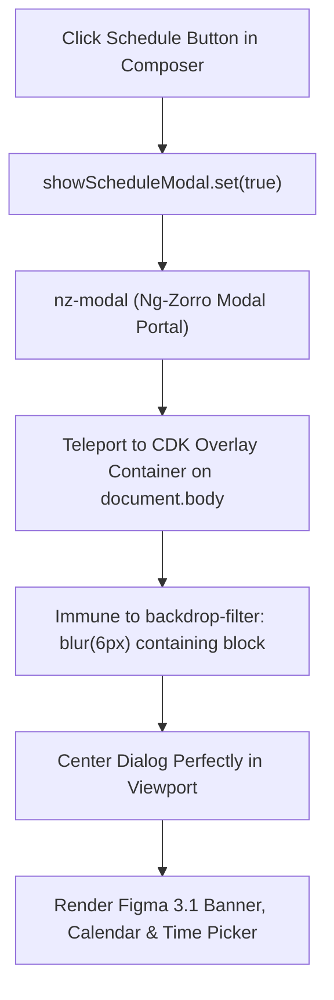

# Phase 02: Schedule Modal nz-modal Teleport Integration

## Context Links
- Plan tổng quan: [plan.md](./plan.md)
- Báo cáo Brainstorm: [brainstormer-261016-1025-composer-emoji-position-schedule-modal-fix.md](../reports/brainstormer-261016-1025-composer-emoji-position-schedule-modal-fix.md)
- Component Modal Lên Lịch: [post-schedule-modal.component.ts](../../src/app/features/ai-social/components/composer/post-schedule-modal/post-schedule-modal.component.ts)
- Container Cha: [emergency-channel-view.component.scss](../../src/app/features/ai-social/views/channels/emergency-channel-view/emergency-channel-view.component.scss)
- Mẫu Tham Chiếu Modal Chuẩn: [ai-social-share-modal.component.ts](../../src/app/features/ai-social/components/share-modal/ai-social-share-modal.component.ts)

## Overview
- **Độ ưu tiên**: Rất cao
- **Trạng thái**: Hoàn thành (Completed)
- **Mô tả**: Tái cấu trúc [PostScheduleModalComponent](../../src/app/features/ai-social/components/composer/post-schedule-modal/) sử dụng `<nz-modal>` từ thư viện `ng-zorro-antd/modal`. Việc teleport dialog ra `cdk-overlay-container` gắn trực tiếp dưới `<body>` sẽ giải thoát hoàn toàn modal khỏi containing block bị giam lỏng bởi thuộc tính `backdrop-filter: blur(6px)` của `.emergency-main-container`, khắc phục 100% hiện tượng "chỉ thấy mờ UI mà không thấy dialog" (Hình 2).

## Key Insights
- **Bản chất lỗi Hình 2**: `.emergency-main-container` có `backdrop-filter: blur(6px)`. Theo chuẩn W3C CSS, bất kỳ phần tử nào có `backdrop-filter` đều biến thành Containing Block cho các phần tử con có `position: fixed`. Do đó, lớp backdrop `.schedule-modal-backdrop` không bám vào viewport mà bám vào container bài viết dài hàng nghìn pixel. Hộp thoại modal bị căn giữa cách đỉnh trang hàng nghìn pixel (dưới đáy cuộn trang), người dùng chỉ nhìn thấy lớp mờ xám mà không thấy dialog.
- **Giải pháp chuẩn**: Sử dụng `<nz-modal>` như `AiSocialShareModalComponent` và `MediaLightboxModalComponent`. `nz-modal` tự động đưa markup ra `document.body`, căn giữa viewport ở mọi độ sâu cuộn trang.
- **Sửa lỗi effect Angular**: Loại bỏ việc gán signal trong `effect()` thiếu an toàn, chuyển việc đồng bộ `selectedDate` sang handler mở modal hoặc effect có `{ allowSignalWrites: true }`.

## Requirements
1. Hộp thoại Lên lịch hiển thị ngay lập tức, căn giữa màn hình (viewport) khi bấm nút lịch, không bị ẩn hay lệch dưới đáy trang.
2. Giữ nguyên 100% thiết kế giao diện Figma:
   - Header tiêu đề "Lên lịch" và nút đóng.
   - Dynamic Notice Banner `#DBE9FF` hiển thị: `Sẽ gửi về thứ {X}, {DD/MM/YYYY} lúc {HH:mm:ss}`.
   - Bộ chọn Ngày với Composite input + Calendar Tháng Popover (Node `#4537:42280`).
   - Bộ chọn Giờ với Composite input + Time Picker Popover (Node `#4537:42815`).
   - Footer: Nút "Huỷ lịch hẹn" và nút "Xác nhận".
3. Toàn bộ mã nguồn TS, HTML, SCSS tuân thủ quy tắc < 200 dòng.

## Architecture


## Related Code Files
- `src/app/features/ai-social/components/composer/post-schedule-modal/post-schedule-modal.component.ts` (CẬP NHẬT)
- `src/app/features/ai-social/components/composer/post-schedule-modal/post-schedule-modal.component.html` (CẬP NHẬT)
- `src/app/features/ai-social/components/composer/post-schedule-modal/post-schedule-modal.component.scss` (CẬP NHẬT)

## Implementation Steps
1. Trong `post-schedule-modal.component.ts`:
   - Import `NzModalModule` từ `ng-zorro-antd/modal`.
   - Cập nhật logic đồng bộ `initialDate` khi modal mở với `{ allowSignalWrites: true }` hoặc trong computed/method.
2. Trong `post-schedule-modal.component.html`:
   - Thay thẻ custom `div.schedule-modal-backdrop` bằng:
     ```html
     <nz-modal
       [nzVisible]="visible()"
       [nzTitle]="null"
       [nzFooter]="null"
       [nzWidth]="560"
       nzClassName="figma-post-schedule-modal"
       (nzOnCancel)="visible.set(false)"
     >
       <ng-container *nzModalContent>
         <!-- Toàn bộ nội dung Figma giữ nguyên -->
       </ng-container>
     </nz-modal>
     ```
3. Trong `post-schedule-modal.component.scss`:
   - Thay đổi styling của backdrop và dialog thành custom class của `nz-modal`, đảm bảo nội dung Figma hiển thị hoàn hảo.
   - Giữ nguyên các popover lịch tháng và time picker.
4. Kiểm thử biên dịch `npm run build` và xác nhận hiển thị.

## Todo List
- [x] Import `NzModalModule` vào `PostScheduleModalComponent`
- [x] Bọc nội dung modal trong `<nz-modal>` và `<ng-container *nzModalContent>`
- [x] Tinh chỉnh SCSS để modal của Ng-Zorro hiển thị đúng bo góc và padding Figma
- [x] Sửa an toàn logic effect khởi tạo state ngày giờ
- [x] Chạy `npm run build` xác thực 0 lỗi

## Success Criteria
- Bấm nút Lên lịch: Hộp thoại Modal hiện lên rõ ràng, sắc nét giữa màn hình ngay lập tức.
- Không còn hiện tượng mờ toàn trang mà không có dialog (Hình 2).
- Chọn ngày/giờ và bấm Xác nhận hoạt động trơn tru.
- Toàn bộ files duy trì dưới 200 dòng.

## Risk Assessment
- *Nguy cơ*: Lớp overlay của Ng-Zorro có padding mặc định làm ảnh hưởng khung dialog.
- *Giảm thiểu*: Sử dụng `nzClassName="figma-post-schedule-modal"` và CSS targeting vào `.ant-modal-content { padding: 0; border-radius: 12px; }`.

## Security Considerations
- Tuân thủ bảo mật OnPush và không rò rỉ bộ nhớ khi đóng/mở modal.

## Next Steps
- Cập nhật `implementation_plan.md` trong thư mục brain artifact để người dùng review và bấm Proceed.
