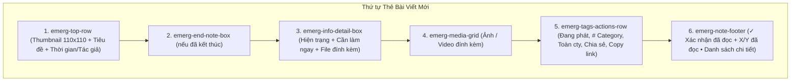

# Phase 01: Relocate Emergency Post Card Tags & Actions Row Above Footer

## Context Links
- Plan tổng quan: [plan.md](./plan.md)
- Báo cáo Brainstorm: [brainstormer-261016-1035-emergency-card-tags-row-relocation.md](../reports/brainstormer-261016-1035-emergency-card-tags-row-relocation.md)
- Template component: [emergency-channel-view.component.html](../../src/app/features/ai-social/views/channels/emergency-channel-view/emergency-channel-view.component.html)
- Style component: [emergency-channel-view.component.scss](../../src/app/features/ai-social/views/channels/emergency-channel-view/emergency-channel-view.component.scss)

## Overview
- **Độ ưu tiên**: Trung bình (Medium)
- **Trạng thái**: Hoàn thành (Completed)
- **Mô tả**: Di chuyển khối `
` (gồm các nhãn Đang phát/Đã kết thúc, `# Phân loại`, Đối tượng nhận tin, và các nút Chia sẻ, Copy link) từ vị trí trên cùng trong `emerg-head-content` xuống nằm ngay phía trên `<footer class="emerg-note-footer">` (phần Xác nhận đã đọc và Danh sách chi tiết).

## Key Insights
- Khi đưa `emerg-tags-actions-row` xuống dưới, tiêu đề bài viết `h2.emerg-title` được nâng lên vị trí cao nhất của cột nội dung bên cạnh thumbnail 110x110. Điều này giúp tiêu đề thông báo khẩn rõ ràng, người đọc không bị phân tâm bởi các nhãn màu sắc trước khi đọc tiêu đề.
- Khối `emergency-post-card` đã có sẵn `display: flex; flex-direction: column; gap: 12px;`, do đó việc đặt `emerg-tags-actions-row` làm con trực tiếp ngay phía trên `emerg-note-footer` sẽ tự động hưởng khoảng cách 12px chuẩn mực, không cần bổ sung wrapper phức tạp.
- File template hiện tại dài 190 dòng, việc chuyển vị trí hoàn toàn giữ nguyên số dòng, tuyệt đối an toàn dưới ngưỡng 200 dòng.

## Requirements
1. Dời toàn bộ khối `emerg-tags-actions-row` từ `emerg-head-content` xuống vị trí nằm ngay trên `emerg-note-footer`.
2. Giữ nguyên toàn bộ logic hoạt động của các nút `Chia sẻ` (`shareRequested.emit`), `Copy link` (`copyPostLink`), các tag `Đang phát` / `Đã kết thúc`, `# Category` và `Audience`.
3. Kiểm tra hiển thị tiêu đề và thời gian đăng ở đầu bài viết để đảm bảo căn lề đẹp mắt cạnh ảnh thumbnail.
4. Đảm bảo toàn bộ các file liên quan tuân thủ nghiêm ngặt < 200 dòng code.

## Architecture

## Related Code Files
- `src/app/features/ai-social/views/channels/emergency-channel-view/emergency-channel-view.component.html` (CẬP NHẬT)
- `src/app/features/ai-social/views/channels/emergency-channel-view/emergency-channel-view.component.scss` (CẬP NHẬT nhẹ nếu cần)

## Implementation Steps
1. Mở `emergency-channel-view.component.html`:
   - Cắt khối `
...
` khỏi `emerg-head-content`.
   - Dán khối này vào vị trí ngay trên `<footer class="emerg-note-footer">`.
2. Kiểm tra `emergency-channel-view.component.scss`:
   - Xác nhận padding/margin giữa `emerg-tags-actions-row` và `emerg-note-footer` cân đối (khoảng cách 12px qua gap của flexbox).
3. Chạy `npm run build` để xác thực biên dịch 0 lỗi.
4. Kiểm tra trực quan trên trình duyệt tại `http://localhost:4205/ai-social/channel/khan`.

## Todo List
- [x] Dời khối `emerg-tags-actions-row` trong `emergency-channel-view.component.html`
- [x] Kiểm tra CSS hiển thị responsive trên desktop & mobile
- [x] Kiểm thử `npm run build` xác thực 0 lỗi
- [x] Xác nhận file < 200 dòng

## Success Criteria
- Tiêu đề thông báo hiển thị ở đỉnh bài viết cạnh thumbnail.
- Hàng tags và nút Chia sẻ / Copy link nằm ngay trên nút Xác nhận đã đọc.
- Build production thành công 100% không phát sinh lỗi.
- File < 200 dòng.

## Risk Assessment
- *Nguy cơ*: Khoảng trống phía dưới tiêu đề cạnh thumbnail 110x110.
- *Giảm thiểu*: `emerg-top-row` đã có `align-items: flex-start;`, cụm tiêu đề + tác giả hiển thị gọn gàng, tự nhiên.

## Security Considerations
- Không thay đổi logic phân quyền hay truyền nhận dữ liệu.

## Next Steps
- Cập nhật `implementation_plan.md` để người dùng xác nhận và thực thi.
