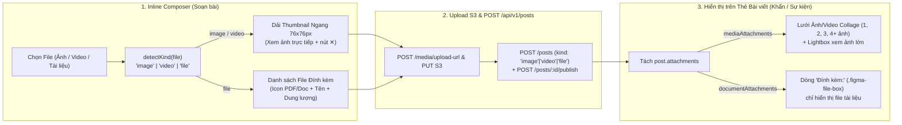

# Báo cáo Phân tích & Giải pháp: Preview Ảnh khi Soạn thảo, Hiển thị Media Grid trên Bài đăng & Fix lỗi `post_attachments_kind_check`

**Ngày tạo:** 2026-10-15  
**Loại báo cáo:** Brainstorm & Root Cause Analysis (`researcher` / `debugger` / `brainstormer`)  
**Trạng thái:** Đã xác định 100% nguyên nhân gốc rễ — Sẵn sàng thực thi (`/cook`)

---

## 1. Phân tích Nguyên nhân Gốc rễ (Root Causes)

### Vấn đề 1: Chưa hiển thị Preview Ảnh/Video dạng Thumbnail khi soạn thảo (`InlineComposerCardComponent`)
- **Hiện trạng ([inline-composer-card.component.html](file:///Users/vinhcuong/Dev/ai-social-web/src/app/features/ai-social/components/composer/inline-composer-card/inline-composer-card.component.html#L115-L128))**:
  - Đang gom chung toàn bộ `attachments()` (cả ảnh `.png/.jpg`, video `.mp4` lẫn file `.pdf`) vào một vòng lặp duy nhất `.preview-file-box` và gắn cứng icon `assets/ai-social/emergency/file-pdf-24.svg`.
  - Dù `AiSocialS3UploadService.createPendingAttachment()` đã tạo sẵn `previewUrl = URL.createObjectURL(file)` cho ảnh/video, nhưng template chưa tách riêng `mediaAttachments` (ảnh/video) để render thẻ `` / `<video>` thumbnail `76×76px` như Mobile (`InlineComposerAttachmentPreviewStrip`).
  - Ngoài ra, khối preview đang nằm bên trong `@if (expanded())` nên nếu người dùng thu gọn khung soạn thảo hoặc đính kèm nhanh ở chế độ gọn thì không thấy ảnh vừa chọn.

### Vấn đề 2: Bài đăng có Ảnh/Video đang bị hiển thị thành dòng File PDF (`EmergencyChannelViewComponent` & `EventChannelViewComponent`)
- **Hiện trạng ([emergency-channel-view.component.html](file:///Users/vinhcuong/Dev/ai-social-web/src/app/features/ai-social/views/channels/emergency-channel-view/emergency-channel-view.component.html#L134-L157))**:
  - Đang duyệt toàn bộ `post.attachments` trong mục `Đính kèm:` và render tất cả bằng `.figma-file-box` kèm icon `file-pdf-24.svg` (khiến `frame_image.png`, `image_2025-07-14_14-39-35.png` bị hiển thị như file PDF).
- **Đối chiếu chuẩn Mobile ([emergency_post_card.dart](file:///Users/vinhcuong/Dev/mobile-GCN-2/mobileapp/STM/packages/gcn_ai_social/lib/src/presentation/widgets/emergency/emergency_post_card.dart#L62-L87) & [post_model.dart](file:///Users/vinhcuong/Dev/mobile-GCN-2/mobileapp/STM/packages/gcn_ai_social/lib/src/data/models/post_model.dart#L112-L115))**:
  - Trên Mobile, `post.attachments` được tách bạch thành 2 danh sách:
    1. **`mediaAttachments`** (`isImage || isVideo`): Hiển thị bằng lưới ảnh/video trực quan **`AiSocialMediaGrid`** (1 ảnh: khung 16:9; 2 ảnh: 2 cột; 3 ảnh: 1 lớn trái + 2 nhỏ phải; 4+ ảnh: lưới 2×2 kèm badge `+N` và bấm vào xem ảnh phóng to Lightbox).
    2. **`documentAttachments`** (`!isImage && !isVideo`): Chỉ các tệp tài liệu thực sự (`.pdf`, `.doc`, `.docx`, `.xls`, `.xlsx`...) mới nằm trong dòng `Đính kèm:` (`.figma-file-box`).

### Vấn đề 3: Lỗi 500 `new row for relation "post_attachments" violates check constraint "post_attachments_kind_check"` khi đăng bài kèm file
- **Hiện trạng trên Web ([ai-social-s3-upload.service.ts](file:///Users/vinhcuong/Dev/ai-social-web/src/app/features/ai-social/services/ai-social-s3-upload.service.ts#L30-L40))**:
  ```ts
  detectKind(file: File): 'image' | 'video' | 'document' {
    ...
    return 'document'; // <-- SAI VỚI RÀNG BUỘC CHECK CỦA POSTGRESQL!
  }
  ```
- **Đối chiếu chuẩn Mobile & Database ([inline_composer_upload_helper.dart](file:///Users/vinhcuong/Dev/mobile-GCN-2/mobileapp/STM/packages/gcn_ai_social/lib/src/presentation/widgets/composer/inline_composer_upload_helper.dart#L41-L71))**:
  - Bảng `post_attachments` trong PostgreSQL có ràng buộc `CHECK (kind IN ('image', 'video', 'file'))` (`post_attachments_kind_check`).
  - Trên Mobile, khi tải tệp tài liệu (PDF/Word/Excel), trường `kind` được truyền là **`'file'`** (`kind: 'image' | 'video' | 'file'`).
  - Do Web truyền `kind: 'document'`, PostgreSQL từ chối bản ghi khi insert vào `post_attachments` và trả về lỗi `500 violates check constraint "post_attachments_kind_check"`.

---

## 2. Phương án Kiến trúc & Thiết kế Chi tiết



### 2.1. Sửa chuẩn `kind: 'image' | 'video' | 'file'` & Luồng Publish bài viết
- Cập nhật [ai-social-s3-upload.service.ts](file:///Users/vinhcuong/Dev/ai-social-web/src/app/features/ai-social/services/ai-social-s3-upload.service.ts) và [ai-social.models.ts](file:///Users/vinhcuong/Dev/ai-social-web/src/app/core/models/ai-social.models.ts):
  - Đổi toàn bộ `'document'` thành **`'file'`** trong `detectKind(file)` và `ComposerPendingAttachment['kind']`.
  - Trong `uploadFileToS3()`, giữ `downloadUrl: presigned.downloadUrl || pending.previewUrl || undefined` để bài vừa đăng hiển thị ngay ảnh sắc nét trên UI trước khi reload trang.
- Cập nhật [ai-social-api.service.ts](file:///Users/vinhcuong/Dev/ai-social-web/src/app/features/ai-social/services/ai-social-api.service.ts):
  - Trong `createPost(payload)`: Sau khi gọi `POST /api/v1/posts`, nếu bài trả về có `status === 'draft'` (giống luồng 2 bước trên Mobile `createPost` → `publishPost`), tự động gọi tiếp `POST /api/v1/posts/${draft.id}/publish` để xuất bản bài viết ngay lập tức.
  - Không nuốt lỗi `4xx/5xx` từ backend khi `status !== 0` để báo thông điệp chính xác và bảo toàn trạng thái form nếu có lỗi mạng.

### 2.2. Hiển thị Preview Ảnh/Video & File tách biệt trong `InlineComposerCardComponent`
- Bổ sung 2 `computed` signals trong [inline-composer-card.component.ts](file:///Users/vinhcuong/Dev/ai-social-web/src/app/features/ai-social/components/composer/inline-composer-card/inline-composer-card.component.ts):
  - `pendingMedia = computed(() => this.attachments().filter(a => a.kind === 'image' || a.kind === 'video'))`
  - `pendingFiles = computed(() => this.attachments().filter(a => a.kind === 'file'))`
- Trong [inline-composer-card.component.html](file:///Users/vinhcuong/Dev/ai-social-web/src/app/features/ai-social/components/composer/inline-composer-card/inline-composer-card.component.html):
  - Đưa vùng hiển thị đính kèm ra hiển thị ngay khi `attachments().length > 0` (kể cả khi chưa mở rộng hết các ô text).
  - **Dải Thumbnail Ảnh/Video (`.composer-media-strip`)**: Hiển thị ngang các ô vuông `76×76px` bo góc `10px`, ảnh `object-fit: cover`, có badge `▶ Video` nếu là video, thanh tiến trình `%` khi đang upload, và nút `✕` tròn nền đen mờ ở góc phải trên để xóa nhanh.
  - **Danh sách Tệp tài liệu (`.attachment-preview-strip`)**: Chỉ hiển thị các tệp `kind === 'file'` với icon tài liệu, tên tệp và dung lượng.

### 2.3. Hiển thị Lưới Ảnh/Video (`Collage Media Grid`) & Lightbox trên Bài đăng (`EmergencyChannelViewComponent` & `EventChannelViewComponent`)
- Trong [emergency-channel-view.component.ts](file:///Users/vinhcuong/Dev/ai-social-web/src/app/features/ai-social/views/channels/emergency-channel-view/emergency-channel-view.component.ts) và [event-channel-view.component.ts](file:///Users/vinhcuong/Dev/ai-social-web/src/app/features/ai-social/views/channels/event-channel-view/event-channel-view.component.ts):
  - Thêm hàm lọc `getMediaAttachments(post)` (lọc các đính kèm là ảnh/video qua `isImageAttachment(att) || isVideoAttachment(att)`) và `getDocumentAttachments(post)` (chỉ lọc các tệp tài liệu).
  - Thêm helper `getMediaUrl(att)` ưu tiên `att.downloadUrl || att.thumbnailUrl || att.fileUrl`.
- Trong [emergency-channel-view.component.html](file:///Users/vinhcuong/Dev/ai-social-web/src/app/features/ai-social/views/channels/emergency-channel-view/emergency-channel-view.component.html):
  - Hiển thị **Khối Lưới Ảnh/Video (`.emerg-media-grid`)** (hỗ trợ bố cục 1 ảnh, 2 ảnh, 3 ảnh, 4+ ảnh kèm số đếm `+N`, bấm vào mở xem ảnh kích thước lớn).
  - Ở mục `Đính kèm:` bên trong `.emerg-info-detail-box`: Chỉ hiển thị khi `getDocumentAttachments(post).length > 0` (chỉ render `.pdf`, `.docx`, `.xlsx`..., tuyệt đối không render ảnh `.png/.jpg` thành hộp file PDF).
- Đồng bộ tương tự cho [event-channel-view.component.html](file:///Users/vinhcuong/Dev/ai-social-web/src/app/features/ai-social/views/channels/event-channel-view/event-channel-view.component.html).

---

## 3. Đề xuất Tiếp theo

Bạn có thể gõ **`/cook`** để mình triển khai ngay toàn bộ 3 hạng mục trên và kiểm tra build!
